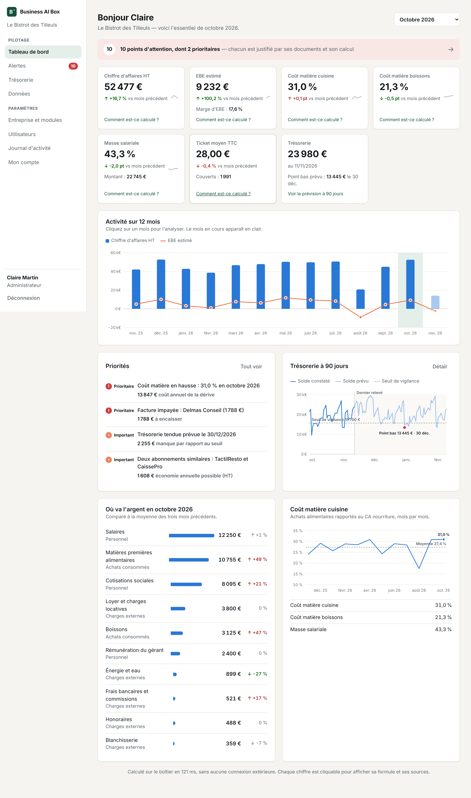

# Business AI Box

Le cerveau numérique privé de l'entreprise : un boîtier installé dans les locaux d'une TPE/PME,
qui centralise ses données, les analyse localement avec une IA embarquée et agit dans ses
logiciels dans les limites fixées par le dirigeant.

- **Cahier des charges** : [docs/cahier-des-charges.md](docs/cahier-des-charges.md)
- **Feuille de route et suivi** : [docs/feuille-de-route.md](docs/feuille-de-route.md)

## Tester sur votre ordinateur

Avec Docker Desktop installé, une seule commande lance l'application et le restaurant de
démonstration sur **http://localhost:8080** (identifiants : `gerant@bistrot.local` /
`demo-bistrot-2026`) :

- Windows : `.\lancer-en-local.ps1`
- Mac / Linux : `./lancer-en-local.sh`

Guide détaillé, IA locale et dépannage : [docs/test-local.md](docs/test-local.md).

## État actuel — v0.5.0 (Phase 5 : connecteurs)



| Fonction | État |
|---|---|
| Installation, comptes, rôles, entreprises, modules, journal d'activité | ✅ Phase 1 |
| Import de factures (PDF, scans, photos), relevé bancaire, journal de caisse | ✅ Phase 2 |
| Tableau de bord, trésorerie à 90 jours, 8 détecteurs d'alertes justifiées | ✅ Phase 2 |
| **Conseiller** : questions en français, 5 agents spécialisés cloisonnés, chaque chiffre sourcé | ✅ Phase 3 |
| **IA locale** (Ollama + Qwen) interchangeable, avec contrôle de chaque chiffre rédigé | ✅ Phase 3 |
| **Agent exécutif** : relances, demandes fournisseurs, résiliations préparées depuis les alertes | ✅ Phase 4 |
| **Autorisations** par type d'action et niveau de risque, validation du dirigeant | ✅ Phase 4 |
| **Niveau 3** : mot de passe et confirmation explicite, jamais automatique (ordre de virement SEPA) | ✅ Phase 4 |
| Journal complet des actions, annulation des actions réversibles, boîte d'envoi | ✅ Phase 4 |
| **Connecteurs** : dossier surveillé, boîte mail (IMAP), Qonto ; permissions fines, identifiants chiffrés | ✅ Phase 5 |
| **Mode « zéro communication externe »** : aucun connecteur en ligne, aucun envoi | ✅ Phase 5 |
| Industrialisation : mini-PC, mises à jour signées, sauvegardes, pilote | Phase 6 |

Restaurant de démonstration complet : voir [docs/demo.md](docs/demo.md).

## Organisation

```
backend/    API Python (FastAPI, SQLAlchemy, Alembic) — PostgreSQL
frontend/   Interface React + TypeScript (Vite)
deploy/     Déploiement sur le boîtier : Docker Compose + Caddy (HTTPS local)
docs/       Cahier des charges et feuille de route
```

## Développement

Prérequis : Python 3.12+, [uv](https://docs.astral.sh/uv/), Node 22+, PostgreSQL 16, Tesseract (OCR).

```bash
# Base de données
sudo -u postgres psql -c "CREATE ROLE bab LOGIN PASSWORD 'bab' CREATEDB"
sudo -u postgres createdb -O bab bab
sudo -u postgres createdb -O bab bab_test

# API — http://127.0.0.1:8000
cd backend
cp .env.example .env
uv sync
uv run alembic upgrade head
uv run uvicorn app.main:app --reload

# Interface — http://localhost:5173 (redirige /api vers l'API)
cd frontend
npm install
npm run dev
```

Au premier accès, l'interface ouvre l'assistant d'installation. Pour charger le restaurant
de démonstration : `uv run python -m app.demo seed` (voir [docs/demo.md](docs/demo.md)).

La lecture des scans et des photos utilise Tesseract, installé sur le poste de développement
(`apt install tesseract-ocr tesseract-ocr-fra`) et dans l'image Docker du boîtier.

### Contrôles

```bash
cd backend && uv run pytest && uv run ruff check . && uv run ruff format --check .
cd frontend && npm run build
```

Les tests reconstruisent le schéma de `bab_test` par les migrations et vérifient que celles-ci
correspondent aux modèles.

## Déploiement sur un boîtier

```bash
cd deploy
cp .env.example .env    # renseigner BAB_DB_PASSWORD
docker compose up -d --build
```

Le boîtier est alors joignable en HTTPS sur `https://businessaibox.local` (certificat émis par
l'autorité interne de Caddy). La base, l'API et le modèle d'IA sont sur un réseau Docker sans
accès sortant. Le modèle se télécharge une fois : `deploy/telecharger-modele.sh qwen2.5:7b`.

Par défaut, le boîtier fonctionne en mode « zéro communication externe ». Pour connecter des
services en ligne (Qonto, messagerie) ou envoyer des courriels :
`docker compose -f docker-compose.yml -f docker-compose.connecteurs.yml up -d`.

En développement, l'API utilise l'Ollama déjà installé sur le poste (`http://127.0.0.1:11434`,
modèle `qwen2.5:7b`, réglables par `BAB_OLLAMA_URL` et `BAB_AI_MODEL`).

## Principes appliqués dès maintenant

- **Zéro communication externe** : l'interface n'appelle que le boîtier (polices système,
  pas de CDN, documentation d'API désactivée hors développement), pas de télémétrie.
- **Indépendance vis-à-vis de l'IA** : calculs, lecture des factures, détection des
  anomalies et brouillons d'actions sont déterministes. Le modèle local ne fait que
  reformuler une réponse déjà calculée ; si un chiffre de sa rédaction n'existe pas dans les
  faits, sa rédaction est écartée. Sans modèle, tout fonctionne.
- **L'IA n'agit jamais seule** : elle ne voit pas les documents bruts (pas d'injection
  d'instructions possible par une facture piégée), ne déclenche rien, et toute action
  engageant l'entreprise attend la validation du dirigeant.
- **Rien n'est inventé** : un montant illisible reste « manquant », un montant déduit est
  marqué « estimé », et chaque impact chiffré affiche sa formule.
- **Moindre privilège** : chaque utilisateur ne voit que les entreprises auxquelles il est
  rattaché ; une entreprise étrangère est indiscernable d'une entreprise inexistante.
- **Traçabilité** : chaque opération sensible, réussie ou refusée, est journalisée sans
  jamais enregistrer de mot de passe.
